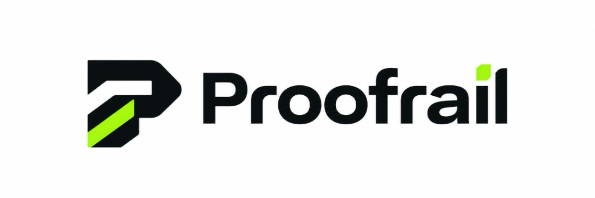

# Proofrail

<p align="center">
  
</p>

> **The Software Supply-Chain Security & Evidence Platform for Modern Engineering Teams.**

Proofrail is an open-core platform that manages the lifecycle of Software Bills of Materials (SBOMs), vulnerability findings, Exploitability eXchange (VEX) statements, and cryptographic release evidence.

Instead of reinventing vulnerability scanners, Proofrail serves as the **security decision, evidence, and workflow management layer** that ingests results from mature open-source security tools (Syft, Trivy, OSV-Scanner, Grype) and provides auditable proof of software security posture.

---

## Key Capabilities

- 📦 **SBOM Inventory & Parsing**: Native ingestion and component extraction for CycloneDX and SPDX JSON formats.
- 🎯 **Vulnerability & Exploitability Management**: Correlate findings to exact project releases and maintain auditable VEX justifications (`not_affected`, `affected`, `fixed`, `under_investigation`).
- 🛡️ **Cryptographic Evidence Packages**: Assemble release SBOMs, VEX decisions, and scan reports into verifiable ZIP bundles with SHA-256 manifests.
- ⚡ **Developer CLI (`proofrail`)**: Native cross-platform Rust CLI for local terminals and CI/CD pipelines.
- 🇪🇺 **CRA Readiness**: Organize technical evidence required for EU Cyber Resilience Act compliance without empty marketing claims.
- 🖥️ **Developer Workspace**: Minimalist, high-density, keyboard-friendly UI inspired by professional engineering tools.

---

## Architecture Overview

Proofrail is organized as a clean monorepo:
- `apps/web`: React 18 + Vite + TypeScript frontend.
- `apps/api`: REST API built with Rust (Axum, Tokio).
- `apps/cli`: Standalone developer CLI tool written in Rust (`clap`, `serde`, `reqwest`).
- `crates/`: Domain, Application, Infrastructure, and Shared business logic libraries.

---

## Quickstart

### Prerequisites
- Node.js 20+ & npm
- Rust 1.80+ (optional for frontend-only dev, required for backend/CLI)
- Docker & Docker Compose (optional for containerized deployment)

### 1. Launch with Docker Compose
```bash
docker compose up -d
```
Access the web console at [http://localhost:3000](http://localhost:3000) and API at [http://localhost:8080](http://localhost:8080).

### 2. Local Direct Run
```bash
# Terminal 1: Backend API
cargo run -p vulnledger-api

# Terminal 2: Web Workspace
cd apps/web
npm install
npm run dev

# Terminal 3: Test the CLI
cargo run -p vulnledger-cli --bin proofrail -- doctor
```

---

## License

Licensed under the Apache License 2.0. See [LICENSE](LICENSE) for details.
